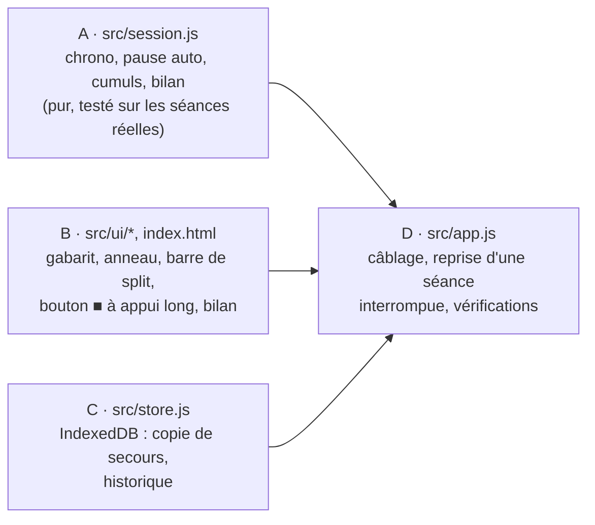

# Plan : écran de séance libre v1 (pause auto, bilan, copie de secours)

Spécification : [ECRAN.md](ECRAN.md), sections « Gabarit commun », « Barre de split », « Séance libre » et « Pause, fin de séance, bilan ». Rendu attendu : [maquette-cinematique.html](maquette-cinematique.html) (séance libre).
Hors périmètre : séances programmées (v2), export JSON (« Ajouter au board » range seulement la séance dans l'historique local), squelette PWA.

## Découpage

Trois briques indépendantes (fichiers disjoints), menées en parallèle, puis une intégration :



| Brique | Fichiers (seuls autorisés) | Tests |
|---|---|---|
| A | `src/session.js`, `test/session.test.js` | `node --test test/session.test.js` |
| B | `index.html`, `src/ui/components.js`, `src/ui/layouts.js`, `src/ui/format.js`, `src/ui/styles.css`, `test/ui.test.js` | `node --test test/ui.test.js` |
| C | `src/store.js`, `test/store.test.js` | `node --test test/store.test.js` |
| D | `src/app.js` (+ retouches mineures) | `npm test`, captures, simulateur, S23 |

## Contrats entre briques

### A → séance (`src/session.js`, pur, temps passé en paramètre)
```js
createSession({ restore } = {})  // restore = objet produit par toJSON()
  .update(values, now)  // values = sortie de activity.update() (dont .state), now en ms ; renvoie snapshot()
  .suspend(now)         // pause forcée (déconnexion Bluetooth) ; reprise au premier coup suivant
  .end(now)             // termine ; renvoie summary()
  .snapshot()           // état courant, voir ci-dessous
  .summary()            // bilan, voir ci-dessous
  .toJSON()             // état sérialisable (copie de secours)
```
`snapshot()` :
```js
{
  status: 'waiting' | 'active' | 'paused' | 'ended',
  elapsed,     // s, temps de rame effectif (pauses exclues), décimal autorisé
  distance,    // m depuis le début de la séance (base = première distance reçue)
  avgSplit,    // s/500 m sur la séance = elapsed * 500 / distance ; null si distance < 10 m
  strokes,     // coups depuis le début
}
```
Règles :
- `waiting` jusqu'au premier `values.state === 'rowing'` ; le chrono démarre à cet instant.
- `active` → `paused` quand `state` devient `stopped` : **la pause est datée du dernier coup**, c'est-à-dire le dernier `now` où `strokeCount` a augmenté (le temps entre ce coup et la détection n'est pas compté).
- `paused` → `active` au premier `state === 'rowing'`, le chrono reprend à ce `now`.
- La distance compte tout ce que le S4 envoie, y compris les quelques mètres d'inertie pendant une pause.
- Cumuls par seconde de rame effective, pour le bilan : puissance moyenne et cadence moyenne (moyennes des valeurs reçues pendant `active`, pondérées par le temps), meilleur 500 m (fenêtre glissante sur des échantillons `(elapsed, distance)`, `null` si moins de 500 m).

`summary()` :
```js
{ startedAt, endedAt,          // ms (now du premier coup / de end())
  duration, distance, strokes, // s, m, coups
  avgSplit, avgPower, avgSpm, best500, // s/500 m, W, coups/min, s ; null si non calculable
  samples: [{ t, d, split, w, spm, strokes }] } // un par seconde de rame effective (pour l'export futur, brief § 11)
```

### B → interface
Le modèle passé à `update(model)` devient :
```js
model = {
  values,        // sortie de activity.update() : instPace, instPower, strokeRate… (null hors effort), state
  session,       // snapshot() de A (ou summary() pour le bilan)
  status,        // connexion : 'connecting' | 'connected' | 'disconnected'
  sourceLabel,
}
```
Gabarit `index.html` : zones `data-zone` = `left`, `center`, `right`, `bar`, plus un indicateur de connexion (point + bandeau « Reconnexion… »). L'écran d'accueil (`#start`, boutons) ne change pas.
Configurations dans `LAYOUTS` (les actions sont passées à la fabrique) :
- `LAYOUTS.free({ onEnd })` : séance libre ; `onEnd()` est appelé après l'appui long sur ■ ;
- `LAYOUTS.summary({ onKeep, onDiscard })` : bilan ; « Ajouter au board » → `onKeep()`, « Ignorer la séance » (appui long) → `onDiscard()`.
Fonctions pures dans `format.js`, testées : position sur la barre (`splitBarPosition(split, { slow: 150, fast: 110 })` → `{ ratio, clamp: 'left' | 'right' | null }`, `ratio` borné à [0, 1]) et géométrie de l'anneau (arcs SVG à partir de fractions), utile aussi en v2.

### C → stockage (`src/store.js`)
```js
createStore({ indexedDB = globalThis.indexedDB, name = 'rower-pwa' } = {})  // tout est async
  .saveDraft(obj) .loadDraft() → obj | null .deleteDraft()   // copie de secours (une seule)
  .saveSession(summary) .listSessions() → [summary]           // historique, clé = startedAt
```
Pas de dépendance : les tests utilisent une petite fausse implémentation d'IndexedDB en mémoire, écrite dans le fichier de test.

### D → câblage
- Chaque trame : `values = activity.update(...)`, `session.update(values, now)`, rendu.
- `status` = `disconnected` → `session.suspend(now)` + bandeau.
- Copie de secours `store.saveDraft(session.toJSON())` toutes les 5 s pendant la séance.
- ■ (appui long) → `session.end()` → bilan. « Ajouter au board » → `saveSession` + `deleteDraft` → accueil. « Ignorer » → `deleteDraft` → accueil.
- Au démarrage, si une copie de secours existe : afficher directement son bilan (`createSession({ restore }).end(...)`), pour la garder ou l'ignorer.

## Critères de fin
1. `npm test` passe, avec de nouveaux tests : pause datée du dernier coup, reprise, coup fantôme sans reprise, temps cumulé sur la séance réelle `s4-2026-11-15-startstop-raw.json`, meilleur 500 m, barre (bornes, ◀ / ▶), stockage.
2. Captures headless à 780 × 360 et 780 × 300 de `?sim=steady` : conformes à la maquette (4 valeurs, anneau, barre, rien ne déborde).
3. Simulateur : la pause et la reprise automatiques fonctionnent (nouveau scénario `startstop` dans `sim.js`, ajouté en D : efforts entrecoupés d’arrêts complets), ■ par appui long mène au bilan, les deux actions reviennent à l'accueil, et la copie de secours survit à un rechargement de page.
4. Sur le S23 avec le vrai rameur : séance avec arrêts, bilan, puis lecture du journal (`phone-eval.js`). Cette étape demande Nico.
