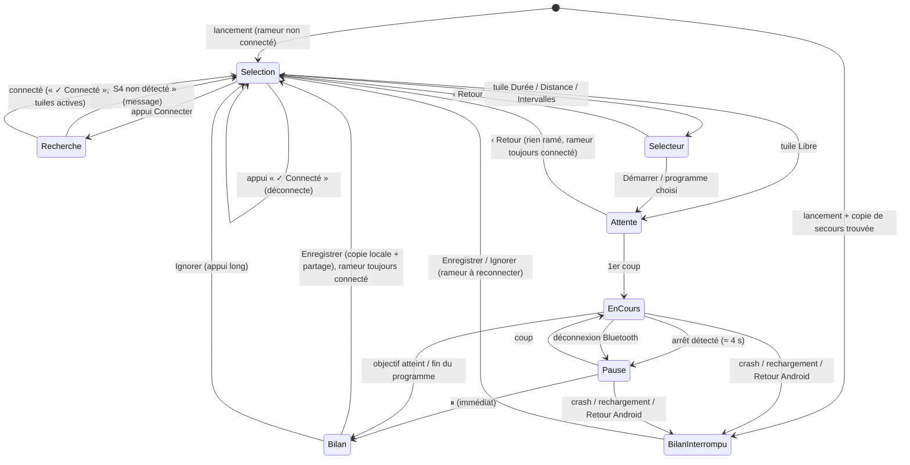

# Cinématique des écrans : parcours v1 de bout en bout

Relevé du 2026-11-18, fait en relisant `src/app.js`, `src/session.js`, `src/ble.js` et `src/ui/layouts.js`. Maquette cliquable correspondante : [maquette-cinematique.html](maquette-cinematique.html) (http://localhost:8080/docs/maquette-cinematique.html). Les écrans eux-mêmes restent décrits dans [ECRAN.md](ECRAN.md).

## Les écrans et leurs états
*Mise à jour du 2026-11-20 : l'écran d'accueil est supprimé, l'appli s'ouvre sur « Sélectionner la séance » (voir [ECRAN.md](ECRAN.md) et la maquette).*

| Écran | États | Où c'est géré |
|---|---|---|
| Sélection de la séance (racine) | rameur non connecté (tuiles grisées) · recherche · connecté (« ✓ Connecté ») ; message court sous le bouton (« S4 non détecté », « Séance enregistrée. »…) | `showChoice`, `mountChoice` (`ui/choice.js`), `startRower`, `disconnectRower` |
| Sélecteur durée / distance, liste des programmes | valeur choisie · programme choisi | `showPicker`, `showPrograms` |
| Séance | `waiting` (bouton « ‹ Retour ») · `active` · `paused` (bouton ⏸) ; en plus, **connexion** `connected` / `disconnected` (bandeau) | `startSession`, `session.js`, `bindSource` |
| Bilan | normal · issu d'une séance interrompue | `showSummary`, `showInterrupted` |

L'orientation n'est plus un état : **paysage partout** (manifeste, `lockLandscape` redemandé à la connexion et à chaque appui).

## Diagramme d'états

Remarque : en attente, un crash retombe sur la **sélection** (`saveDraft` n'écrit rien tant que le statut est `waiting`), rameur à reconnecter.

## Transitions : événement → effet de bord

| Événement | Transition | Effets de bord |
|---|---|---|
| Appui Connecter | Sélection → Recherche | `connecting = true`, bouton « Recherche… » atténué, tuiles grisées ; `getDevices()` (5 s max) puis sélecteur Chrome |
| Rameur trouvé | Recherche → Sélection connectée | « ✓ Connecté », tuiles actives, paysage redemandé (`lockLandscape`), écran maintenu allumé seulement en séance |
| Rameur introuvable | Recherche → Sélection | message court « S4 non détecté » (toutes les causes), détail dans le journal, `disconnect()` pour ne pas laisser de lien fantôme |
| Appui « ✓ Connecté » | Connecté → non connecté | `source.disconnect()` : le S4 est libéré pour une autre appli |
| ‹ Retour (attente) | Attente → Sélection | copie de secours supprimée, **rameur toujours connecté**, pas de bilan ; ignoré si le premier coup est arrivé entre-temps |
| 1er coup | Attente → En cours | chrono lancé, distance et coups comptés à partir de là |
| Arrêt ≈ 4 s | En cours → Pause | pause **datée du dernier coup**, chrono affiché figé, ⏸ visible |
| Coup | Pause → En cours | reprise au premier coup (même un coup léger) |
| Déconnexion BLE | → Pause + bandeau | `session.suspend`, reconnexion automatique en boucle (1 s → 10 s) |
| ⏸ en pause | Pause → Bilan | `session.end`, copie de secours conservée jusqu'à Enregistrer / Ignorer |
| Enregistrer | Bilan → Sélection | `share()` lancé dans le geste, copie locale, retour immédiat, message « Séance enregistrée. » puis résultat du partage **seulement s'il complète ce message** |
| Ignorer (appui long) | Bilan → Sélection | copie de secours supprimée, pas de message |
| Page tuée / rechargée | → Bilan interrompu | copie de secours relue au démarrage (1,5 s max, sinon affichée tardivement si la sélection est encore là) |

## Écarts repérés

Chaque ligne se reproduit dans la maquette (boutons grisés ou lignes ⚠ du journal).

| # | Écart | Gravité | Proposition |
|---|---|---|---|
| 1 | **Bilan d'une séance interrompue ouvert en portrait** : `showInterrupted` ne rappelle pas `lockLandscape`, donc le téléphone en portrait affiche seulement « Tourne le téléphone », sans bouton ni explication. Il faut deviner qu'il y a un bilan à traiter. | Moyenne | Verrouiller le paysage aussi pour le bilan interrompu, et le dire (« Séance interrompue retrouvée ») |
| 2 | ✔ **Corrigé (2026-11-20)** — Message de partage qui écrase un autre message : le résultat du partage ne complète plus que le message « Séance enregistrée. » qui lui correspond. | Corrigé | N'afficher le résultat du partage que si l'accueil est encore au repos, sinon l'ignorer |
| 3 | **Bouton Retour Android non géré** : en séance comme sur le bilan, le geste de retour quitte la page. Séance perdue (≤ 5 s près) mais récupérée au lancement suivant. | Moyenne | Intercepter `popstate` : en séance, ne rien faire (ou demander de passer par ⏸) ; sur le bilan, idem |
| 4 | **Reconnexion sans fin** : la boucle ne s'arrête jamais. La déconnexion met la séance en pause, donc ⏸ (la sortie) apparaît bien ; mais rien n'indique de s'en servir quand le rameur reste injoignable. | Faible | Après N tentatives, texte du bandeau « Rameur injoignable : appuie sur ⏸ pour terminer » |
| 5 | **Recherche non annulable** : le bouton reste atténué (« Recherche… ») jusqu'à la réponse de Chrome, sans moyen de renoncer (sélecteur Bluetooth fermé par l'utilisateur = `NotFoundError`, donc OK ; mais `getDevices()` + connexion GATT peuvent durer). | Faible | Éventuellement un « Annuler » |
| 6 | ✔ **Corrigé (2026-11-20)** — Message périmé : « Séance enregistrée… » s'efface au démarrage de la séance suivante ou au prochain appui Connecter. | Corrigé |
| 7 | **⏸ en pause = fin immédiate, sans retour possible** : décision déjà prise ([ECRAN.md](ECRAN.md)), mais un appui accidentel pendant une pause de récupération termine la séance (le bilan existe, la séance ne reprend pas). | Décidé | À réévaluer après la séance de 20 min avec arrêts |
| 8 | Déconnexion pendant le bilan : le rameur reste connecté (frames ignorées) jusqu'à l'appui sur « ✓ Connecté » (le rameur reste connecté entre deux séances, voulu pour les enchaîner). Le S4 n'accepte qu'une connexion : WaterRower Connect ne peut pas se connecter pendant ce temps. | Faible | Déconnecter la source dès l'affichage du bilan |
| 9 | Séance vide (`startedAt == null`) sur le bilan : code défensif, **non atteignable** aujourd'hui (la copie de secours n'existe pas en attente et « ‹ Retour » en attente évite le bilan). | OK | Laisser tel quel |

## Ce qui est déjà cohérent
- Un seul chemin pour sortir de chaque état (⏸ puis Enregistrer / Ignorer, ou « ‹ Retour » direct en attente).
- La séance ne se perd jamais : copie de secours toutes les 5 s, écrite aussi au passage en arrière-plan, bilan au relancement.
- Un seul appui par issue du bilan (`settled`).

## Suite proposée
À trancher avec Nico, puis corrections dans `src/app.js` (et `layouts.js` pour les libellés) : en priorité les écarts 1, 2 et 3, ensuite 8 ; les 4, 5, 6 si le test réel les rend gênants. Les écrans ajoutés depuis (section suivante) ne figurent pas encore dans le diagramme d'états ci-dessus.

## Écrans ajoutés depuis (2026-11-20, v2 en cours)

Tous présents dans la maquette unique [maquette-cinematique.html](maquette-cinematique.html) ; décisions de conception dans [ECRAN.md](ECRAN.md). **Codés et testés sous Node, pas encore essayés sur le S23.**

- **Choix de séance** (`showChoice`, `ui/choice.js`) : après la connexion, quatre choix : Libre, Durée, Distance, Intervalles.
- **Sélecteurs durée / distance** (`mountPicker`, `goal.js`) : sélecteur circulaire d'objectif, bouton de départ, retour au choix.
- **Liste des programmes** (`showPrograms`, `programs.js`) : 6 programmes d'intervalles ; un appui lance le programme (`startProgram`).
- **Séance durée / distance** : même gabarit que la séance libre, anneau = progression vers l'objectif.
- **Séance HIIT** (`engine.js`, `target.js`) : anneau par phase (échauffement, frise d'un bloc d'efforts et récups, récup longue, retour au calme), compte à rebours, zone cible de split pendant les efforts. Le programme suit l'horloge murale : pas de « EN PAUSE » à l'écran.
- **Fin automatique** : à l'objectif atteint (durée ou distance) ou à la fin du programme, la séance se termine seule et mène au bilan, sans appui sur ⏸.
