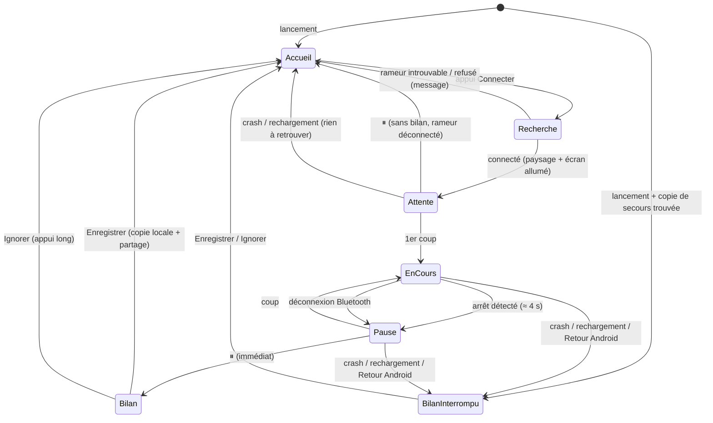

# Cinématique des écrans : parcours v1 de bout en bout

Relevé du 2026-11-18, fait en relisant `src/app.js`, `src/session.js`, `src/ble.js` et `src/ui/layouts.js`. Maquette cliquable correspondante : [maquette-cinematique.html](maquette-cinematique.html) (http://localhost:8080/docs/maquette-cinematique.html). Les écrans eux-mêmes restent décrits dans [ECRAN.md](ECRAN.md).

## Les trois écrans et leurs états

| Écran | États | Où c'est géré |
|---|---|---|
| Accueil | repos · recherche en cours (bouton grisé) · message (erreur, enregistrement, partage) | `#start`, `startRower`, `goHome` |
| Séance | `waiting` (attente du 1er coup) · `active` · `paused` ; en plus, **connexion** `connected` / `disconnected` (bandeau) | `startSession`, `session.js`, `bindSource` |
| Bilan | normal · issu d'une séance interrompue | `showSummary`, `showInterrupted` |

L'orientation est un **état à part** : libre à l'accueil, verrouillée en paysage dès la connexion (`lockLandscape`), libérée au retour (`freeOrientation`).

## Diagramme d'états

Remarque : en attente, un crash retombe sur l'**accueil** (`saveDraft` n'écrit rien tant que le statut est `waiting`).

## Transitions : événement → effet de bord

| Événement | Transition | Effets de bord |
|---|---|---|
| Appui Connecter | Accueil → Recherche | `connecting = true`, bouton grisé, message « Recherche du rameur… » ; `getDevices()` (5 s max) puis sélecteur Chrome |
| Rameur trouvé | Recherche → Attente | `startSession` : paysage verrouillé (ou plein écran), wake lock, copie de secours toutes les 5 s, `rotate-hint` si le verrouillage est refusé |
| Rameur introuvable | Recherche → Accueil | message selon `BLE_ERRORS`, `disconnect()` pour ne pas laisser de lien fantôme |
| 1er coup | Attente → En cours | chrono lancé, distance et coups comptés à partir de là |
| Arrêt ≈ 4 s | En cours → Pause | pause **datée du dernier coup**, chrono affiché figé, ⏸ visible |
| Coup | Pause → En cours | reprise au premier coup (même un coup léger) |
| Déconnexion BLE | → Pause + bandeau | `session.suspend`, reconnexion automatique en boucle (1 s → 10 s) |
| ⏸ en attente | Attente → Accueil | copie de secours supprimée, rameur déconnecté, pas de bilan |
| ⏸ en pause | Pause → Bilan | `session.end`, copie de secours conservée jusqu'à Enregistrer / Ignorer |
| Enregistrer | Bilan → Accueil | `share()` lancé dans le geste, copie locale, accueil immédiat, message « Séance enregistrée. » puis résultat du partage |
| Ignorer (appui long) | Bilan → Accueil | copie de secours supprimée, pas de message |
| Page tuée / rechargée | → Bilan interrompu | copie de secours relue au démarrage (1,5 s max, sinon affichée tardivement si l'accueil est encore là) |

## Écarts repérés

Chaque ligne se reproduit dans la maquette (boutons grisés ou lignes ⚠ du journal).

| # | Écart | Gravité | Proposition |
|---|---|---|---|
| 1 | **Bilan d'une séance interrompue ouvert en portrait** : `showInterrupted` ne rappelle pas `lockLandscape`, donc le téléphone en portrait affiche seulement « Tourne le téléphone », sans bouton ni explication. Il faut deviner qu'il y a un bilan à traiter. | Moyenne | Verrouiller le paysage aussi pour le bilan interrompu, et le dire (« Séance interrompue retrouvée ») |
| 2 | **Message de partage qui écrase un autre message** : `sharing.then(...)` réécrit `startMsg` quand la feuille de partage répond, même si on a déjà appuyé sur Connecter (« Recherche du rameur… » disparaît alors que le bouton reste grisé). | Moyenne | N'afficher le résultat du partage que si l'accueil est encore au repos, sinon l'ignorer |
| 3 | **Bouton Retour Android non géré** : en séance comme sur le bilan, le geste de retour quitte la page. Séance perdue (≤ 5 s près) mais récupérée au lancement suivant. | Moyenne | Intercepter `popstate` : en séance, ne rien faire (ou demander de passer par ⏸) ; sur le bilan, idem |
| 4 | **Reconnexion sans fin** : la boucle ne s'arrête jamais. La déconnexion met la séance en pause, donc ⏸ (la sortie) apparaît bien ; mais rien n'indique de s'en servir quand le rameur reste injoignable. | Faible | Après N tentatives, texte du bandeau « Rameur injoignable : appuie sur ⏸ pour terminer » |
| 5 | **Recherche non annulable** : le bouton est grisé jusqu'à la réponse de Chrome, sans moyen de renoncer (sélecteur Bluetooth fermé par l'utilisateur = `NotFoundError`, donc OK ; mais `getDevices()` + connexion GATT peuvent durer). | Faible | Libellé « Recherche… » sur le bouton, éventuellement un « Annuler » |
| 6 | **Message d'accueil périmé** : « Séance enregistrée… » reste affiché jusqu'au prochain appui Connecter. Anodin, mais l'écran d'accueil garde une information datée. | Faible | Effacer après quelques secondes ou à la rotation |
| 7 | **⏸ en pause = fin immédiate, sans retour possible** : décision déjà prise ([ECRAN.md](ECRAN.md)), mais un appui accidentel pendant une pause de récupération termine la séance (le bilan existe, la séance ne reprend pas). | Décidé | À réévaluer après la séance de 20 min avec arrêts |
| 8 | Déconnexion pendant le bilan : le rameur reste connecté (frames ignorées) jusqu'à `goHome`. Le S4 n'accepte qu'une connexion : WaterRower Connect ne peut pas se connecter pendant ce temps. | Faible | Déconnecter la source dès l'affichage du bilan |
| 9 | Séance vide (`startedAt == null`) sur le bilan : code défensif, **non atteignable** aujourd'hui (la copie de secours n'existe pas en attente et ⏸ en attente évite le bilan). | OK | Laisser tel quel |

## Ce qui est déjà cohérent
- Un seul chemin pour sortir de chaque état (⏸ puis Enregistrer / Ignorer, ou l'accueil direct en attente).
- La séance ne se perd jamais : copie de secours toutes les 5 s, écrite aussi au passage en arrière-plan, bilan au relancement.
- Un seul appui par issue du bilan (`settled`).
- L'orientation est toujours libérée au retour à l'accueil.

## Suite proposée
À trancher avec Nico, puis corrections dans `src/app.js` (et `layouts.js` pour les libellés) : en priorité les écarts 1, 2 et 3, ensuite 8 ; les 4, 5, 6 si le test réel les rend gênants. Les écrans de la v2 (choix du type de séance, HIIT) viendront enrichir ce diagramme.
